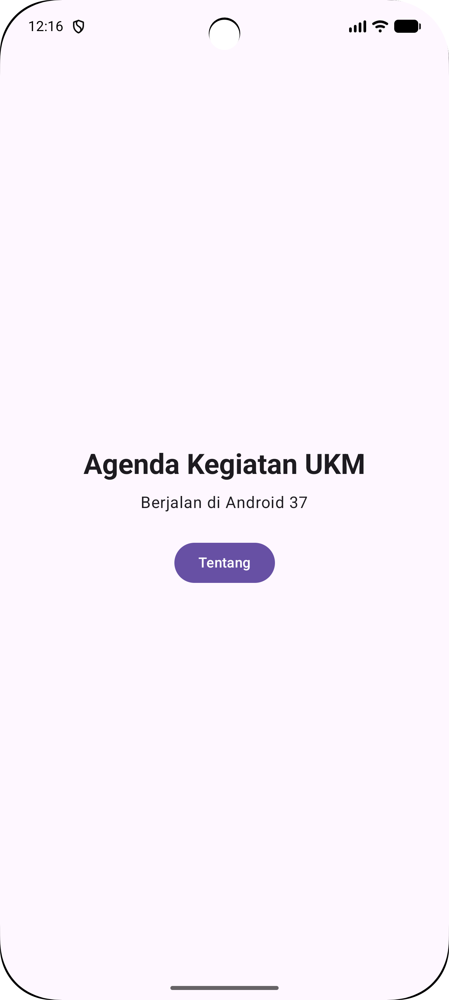
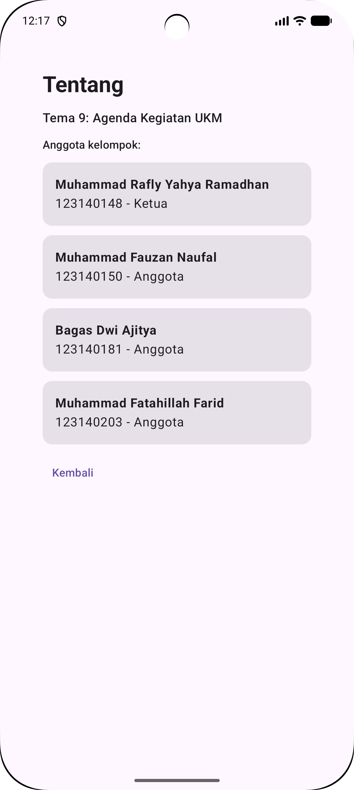

# Pekan 1 — Proyek KMP Kelompok (Tema 9: Agenda Kegiatan UKM)

Checkpoint minggu 1, dibuat dari template Compose Multiplatform.

## Yang sudah ada
- Judul aplikasi diganti jadi **Agenda Kegiatan UKM** (tema 9).
- Nama platform tampil lewat `expect`/`actual` (`getPlatform()` di `Platform.kt`, `Platform.android.kt`, `Platform.ios.kt`, `Platform.jvm.kt`).
- Layar **Tentang** menampilkan nama dan NIM anggota dari `Anggota.kt`. Berisi empat anggota kelompok beserta perannya.

## Anggota
| Nama | NIM | Peran |
| --- | --- | --- |
| Muhammad Rafly Yahya Ramadhan | 123140148 | Ketua |
| Muhammad Fauzan Naufal | 123140150 | Anggota |
| Bagas Dwi Ajitya | 123140181 | Anggota |
| Muhammad Fatahillah Farid | 123140203 | Anggota |

## Screenshot
| Beranda | Tentang |
|:---:|:---:|
|  |  |

## Cara menjalankan
- Android: buka folder `pekan-1` di Android Studio, jalankan `androidApp`. Atau `./gradlew :androidApp:assembleDebug`
- Desktop: `./gradlew :desktopApp:run`
- iOS: buka `iosApp/iosApp.xcodeproj` di Xcode lalu Run.
